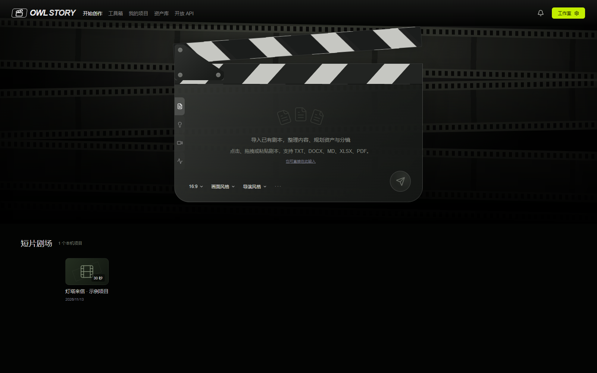
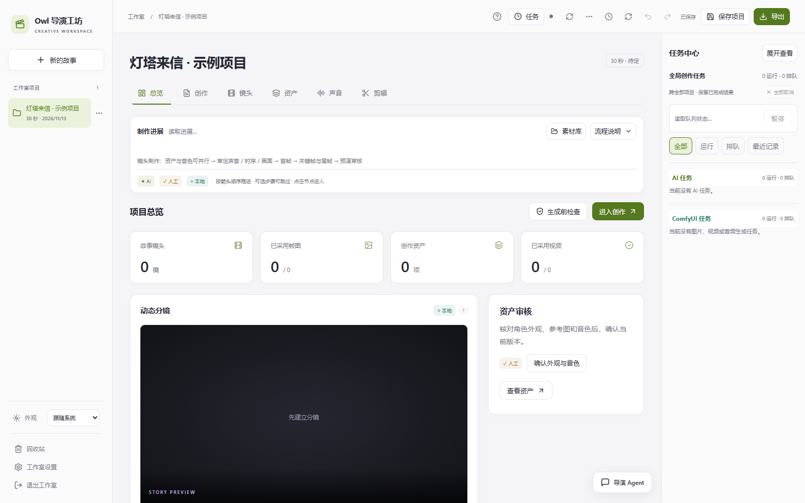

# Owl 导演工坊

Owl 是一个本地优先的 AI 视频创作工作台。把故事、剧本、资产、分镜、提示词和媒体版本放在同一个项目中，按阶段编辑、审核并跟踪任务。





截图来自独立运行的 Owl 实例，示例故事为虚构内容。

## 从一段故事到什么成品？

**你可以从一句创意、一段故事或已有剧本文字开始。** Owl 把这些文字组织成可逐项修改的剧本、角色与场景资产、分镜和生成提示词。你可以在分镜和提示词阶段停下来交给团队制作，也可以配置生成服务，继续做到带画面和声音的预览。

| 阶段 | 手头需要有什么 | 这一步做完得到什么 |
| --- | --- | --- |
| 建项目 | 一段故事或创意，以及大致时长、画幅等要求 | 保存了原始故事和创作设定的项目，可以随时继续编辑 |
| 写剧本 | 故事和你选定的改编方式 | 可复核的剧本，明确场次、人物行动和对白 |
| 整理资产 | 剧本中会反复出现的人物、地点和物件 | 角色、场景、道具资产卡，可以补充外观描述、提示词和参考素材 |
| 做分镜 | 剧本、资产和成片时长 | 按镜头排列的拍摄说明，可以逐镜修改画面内容、景别、机位、运镜、时长和参考素材 |
| 准备画面 | 镜头内容与可用的参考素材 | 首尾帧或关键帧的画面描述、镜头提示词。配置出图工作流后，可把生成图作为镜头参考 |
| 制作视频与声音 | 已复核的镜头提示词、参考图或帧图，以及配置好的生成服务 | 可逐镜比较的生成版本，按镜头选用画面，按需要补对白、配音或其他音轨 |
| 预览与交付 | 选用的镜头视频及所需音轨 | 在项目里检查镜头顺序和音画衔接，使用导出入口打包已有项目素材 |

### 用「灯塔来信」走一遍

1. 在首页点「新的故事」，粘贴下方示例，先设成 30 秒短片。
2. 进入「创作」，把故事整理成三段动作，例如收到信、带钥匙登塔、看到海上三次闪光。检查剧本有没有保留钥匙和闪光这两个线索。
3. 到「资产」整理林舟、灯塔和旧铜钥匙。给林舟固定衣着，给钥匙固定外形，把这些资产关联到用到它们的镜头。
4. 到「镜头」设计三个镜头，例如信封特写、跟拍登塔、塔顶望向海面。给每镜填写时长、机位和运镜，再写首尾画面与镜头提示词。到这一步，你已经有一份可交给制作人员继续执行的分镜方案。
5. 如果已接入生成服务，可继续生成帧图和镜头视频，在多个版本里选用满意的一版，再到「声音」和「剪辑」检查配音、顺序和衔接。提交后的排队、执行状态和历史记录可从右侧「任务中心」查看。

### 安装后能直接做哪些事？

- **只运行 Owl**即可建立和保存项目、手动整理剧本、资产、分镜及提示词。适合先完成策划和制作准备。
- **配置文字 AI**后，可以调用 AI 辅助写剧本、整理资产或准备分镜和提示词。涉及模型调用时，输入会发送给你配置的服务。
- **配置生成服务与工作流**后，可以从文字和参考素材继续生成图像、视频或声音。模型、ComfyUI 节点、工作流和服务凭据需按功能分别准备。最终预览和导出取决于项目已有的画面与音频素材。

## 本地启动

准备 Python 3.11+ 和 Node.js 20+。在仓库根目录运行以下 PowerShell 命令。

```powershell
python -m venv .venv
.\.venv\Scripts\python.exe -m pip install -r requirements.txt
npm ci
npm run build
.\.venv\Scripts\python.exe -m uvicorn backend.app:app --host 127.0.0.1 --port 8768
```

浏览器打开 [本地工作台](http://127.0.0.1:8768/)，首次访问设置至少八个字符的工作室密码。选择「新的故事」创建项目，随后从总览进入创作、镜头或资产。可将下面的文字粘贴为示例故事。

> 暴雨来临前，灯塔管理员林舟收到一封没有署名的信。他带着旧铜钥匙走上塔顶，看见海面亮起三次灯光。

基础项目编辑使用本地存储。AI 写作、图片、视频和声音生成需要在「工作室设置」中配置相应服务。使用 ComfyUI 时，请先自行启动服务并安装工作流所需的节点和模型，再填写连接地址和工作流。各服务是否产生费用取决于你配置的提供方。

默认数据目录是 `data/`，可在启动前用 `DIRECTOR_STUDIO_DATA` 指定其他位置。项目、设置、生成素材和凭据应保存在本地数据目录。

## 目录

| 路径 | 内容 |
| --- | --- |
| `src/` | React 与 TypeScript 界面 |
| `backend/` | FastAPI、项目存储、任务调度及生成服务接入 |
| `rules/` | 创作规则 |
| `tests/` | 本地回归测试 |
| `docs/screenshots/` | 示例界面截图 |

## 许可证

Owl 自有代码采用 [MIT 许可证](LICENSE)。第三方内容遵循各自附带的许可证和署名要求。

首发源码包含创作工作台。由本机导入的第三方技能资料、示例媒体和案例目录需按各自来源另行取得。外部生成工作流需要用户自行配置。
